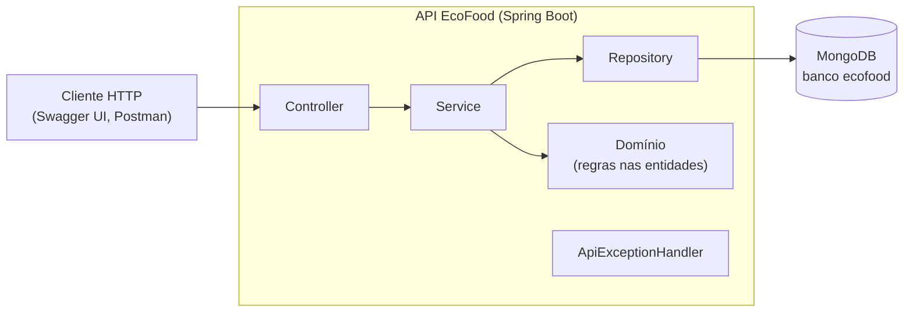
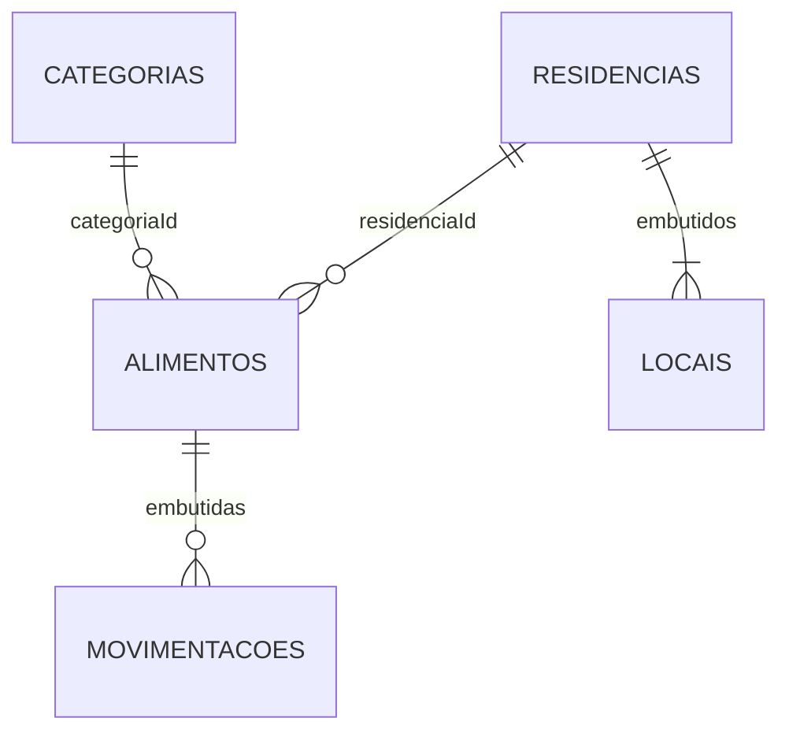

# EcoFood

O EcoFood é uma API REST desenvolvida como Prova de Conceito (PoC) para a AEP do curso de Engenharia de Software.

A aplicação controla os alimentos guardados em cada residência: onde estão (geladeira, freezer, despensa), quanto resta, quando vencem e o que foi consumido, doado ou jogado fora. Com isso, avisa o que está perto de vencer e mostra quanto da comida comprada foi realmente aproveitado.

**Versão atual: 2.0.0 (2ª entrega).**

## Problema

O desperdício de alimentos dentro de casa acontece, em grande parte, por falta de controle: os produtos ficam espalhados entre despensa, geladeira e freezer, e a validade só é percebida quando o alimento já venceu. Sem registro do que foi jogado fora, a família também não sabe quanto desperdiça nem o que costuma estragar.

O EcoFood oferece esse registro: cada residência cadastra seus locais de armazenamento e seus alimentos, registra o consumo, as doações e os descartes, e recebe alertas de validade e um relatório de aproveitamento.

## Público-alvo

Famílias e residências que precisam acompanhar os alimentos guardados em casa. O mesmo modelo serve para pequenos estabelecimentos de alimentação, que enfrentam o problema em escala maior.

## ODS 12 — Consumo e Produção Responsáveis

O projeto está alinhado ao Objetivo de Desenvolvimento Sustentável 12 da ONU, em especial à meta 12.3, que propõe reduzir pela metade, até 2030, o desperdício de alimentos per capita no varejo e no consumo.

O EcoFood contribui de três formas:

- **prevenção:** alertas de validade conforme o tipo de alimento, para consumir ou doar antes de vencer;
- **destinação responsável:** a doação é registrada como saída aproveitada, e não como perda;
- **medição:** o relatório de desperdício mostra o percentual de aproveitamento e os alimentos mais descartados, para a família mudar seus hábitos de compra.

## Evolução da 1ª para a 2ª entrega

| Aspecto | 1ª entrega (v1.0) | 2ª entrega (v2.0) |
|---|---|---|
| Coleções | 1 (`alimentos`) | 3 (`residencias`, `categorias`, `alimentos`) |
| Documentos | simples e homogêneos | com subdocumento (`endereco`) e listas de subdocumentos (`locais`, `movimentacoes`) |
| Relacionamentos | nenhum | alimento → residência e alimento → categoria, por `ObjectId` |
| Categoria | texto livre | coleção própria, com dias de antecedência do alerta |
| Estoque | quantidade fixa | atualizado a cada consumo, descarte, doação ou reposição |
| Funcionalidades | CRUD de alimentos | CRUD das 3 coleções, movimentações, alertas de validade e relatório de desperdício |
| Regras de negócio | validação de campos | também integridade entre coleções, estoque e locais da residência |
| Índices | só `_id` | nome único da categoria, residência + validade, categoria |
| Testes | 18 testes, 97,5% das linhas | 133 testes (13 com MongoDB embutido), 99,5% das linhas |
| Execução | exigia Maven instalado | Maven Wrapper incluído e Swagger UI para testar pelo navegador |

O histórico completo está no [CHANGELOG](CHANGELOG.md).

## Funcionalidades

- Cadastro de residências com endereço e locais de armazenamento.
- Cadastro de categorias de alimento com dias de alerta e dicas de conservação.
- Cadastro de alimentos ligados a uma residência, a uma categoria e a um local da casa.
- Registro de movimentações (consumo, descarte, doação e reposição), que atualizam o estoque.
- Alertas de validade por residência: vencidos, vencendo hoje e perto do vencimento.
- Relatório de desperdício por residência: consumido, doado e descartado por unidade de medida, percentual de aproveitamento e alimentos mais descartados.
- Proteção das ligações entre coleções: não é possível excluir uma residência ou categoria em uso, nem remover da casa um local que ainda guarda alimentos.

## Arquitetura



- **Controller:** recebe as requisições, valida os DTOs de entrada e devolve as respostas.
- **Service:** coordena os casos de uso e confere as referências entre coleções. `ServicoCrud<T>` concentra as operações comuns.
- **Domínio:** as entidades guardam suas regras, como "não tirar mais do que o estoque" e "não repetir local na mesma casa".
- **Repository:** Spring Data MongoDB, com consultas derivadas e agregações.
- **ApiExceptionHandler:** padroniza as respostas de erro (400, 404, 409 e 422).

Detalhes, diagrama de classes e princípios de orientação a objetos em [docs/arquitetura.md](docs/arquitetura.md).

## Tecnologias

- Java 21
- Spring Boot 3.5 (Web, Validation, Data MongoDB)
- MongoDB (testado com as versões 8.0 e 8.3)
- springdoc-openapi (Swagger UI)
- Maven, com Maven Wrapper
- JUnit 5, Mockito, MockMvc e JaCoCo
- Flapdoodle Embedded MongoDB (testes de integração)

## Banco de dados

Banco `ecofood` no MongoDB, com três coleções:

| Coleção | O que guarda | Estrutura |
|---|---|---|
| `residencias` | casas que usam o sistema | `endereco` (subdocumento) e `locais` (lista de subdocumentos) |
| `categorias` | tipos de alimento | `diasAlertaValidade` e `dicasConservacao` (lista) |
| `alimentos` | alimentos guardados | referências `residenciaId` e `categoriaId` e `movimentacoes` (lista de subdocumentos) |



Exemplo de documento da coleção `alimentos`:

```json
{
  "_id": { "$oid": "6af3761d47b97c882d4738fb" },
  "nome": "Tomate",
  "residenciaId": { "$oid": "6af3761d47b97c882d4738f4" },
  "categoriaId": { "$oid": "6af3761d47b97c882d4738f1" },
  "local": "Geladeira",
  "quantidade": { "$numberDecimal": "0.4" },
  "unidade": "kg",
  "dataValidade": { "$date": "2026-11-13T03:00:00Z" },
  "movimentacoes": [
    { "tipo": "CONSUMO", "quantidade": { "$numberDecimal": "0.4" }, "data": { "$date": "2026-11-08T03:00:00Z" } },
    { "tipo": "DESCARTE", "quantidade": { "$numberDecimal": "0.2" }, "data": { "$date": "2026-11-09T03:00:00Z" }, "observacao": "Dois tomates estragados" }
  ]
}
```

Os campos de cada coleção, os exemplos completos, os índices, as agregações e a escolha entre embutir e referenciar estão em [docs/banco-de-dados.md](docs/banco-de-dados.md).

## Como executar

### Pré-requisitos

- Java 21
- MongoDB rodando em `localhost:27017`

O Maven não precisa estar instalado: o projeto traz o Maven Wrapper (`mvnw` / `mvnw.cmd`).

### Subir a API

Windows:

```bash
mvnw.cmd spring-boot:run
```

Linux e macOS:

```bash
./mvnw spring-boot:run
```

Se aparecer "permission denied" no Linux ou no macOS, rode `chmod +x mvnw` antes.

A API fica em `http://localhost:8080`, e o Swagger UI em **http://localhost:8080/swagger-ui.html**.

Para usar outro banco, defina a variável de ambiente `MONGODB_URI` (o padrão é `mongodb://localhost:27017/ecofood`). Para usar outra porta:

```bash
mvnw.cmd spring-boot:run -Dspring-boot.run.arguments=--server.port=8090
```

### Carregar dados de exemplo

O script [scripts/dados-exemplo.js](scripts/dados-exemplo.js) cria 5 categorias, 2 residências e 13 alimentos com movimentações. As datas são calculadas a partir do dia em que ele roda, então sempre há alimentos vencidos, vencendo hoje e perto do vencimento.

```bash
mongosh "mongodb://localhost:27017/ecofood" scripts/dados-exemplo.js
```

> **Atenção:** o script apaga e recria as coleções `residencias`, `categorias` e `alimentos` do banco informado.

No fim, ele mostra os ids das residências, para usar nos endpoints de relatório.

## Endpoints

| Método | Caminho | Resultado |
|---|---|---|
| POST | `/residencias` | Cadastra uma residência com endereço e locais (201) |
| GET | `/residencias` | Lista as residências |
| GET | `/residencias/{id}` | Busca uma residência (200 ou 404) |
| PUT | `/residencias/{id}` | Atualiza uma residência (200, 404 ou 422) |
| DELETE | `/residencias/{id}` | Exclui uma residência sem alimentos (204, 404 ou 422) |
| POST | `/residencias/{id}/locais` | Adiciona um local de armazenamento (201 ou 422) |
| POST | `/categorias` | Cadastra uma categoria (201 ou 422) |
| GET | `/categorias` | Lista as categorias |
| GET | `/categorias/{id}` | Busca uma categoria (200 ou 404) |
| PUT | `/categorias/{id}` | Atualiza uma categoria (200, 404 ou 422) |
| DELETE | `/categorias/{id}` | Exclui uma categoria sem alimentos (204, 404 ou 422) |
| POST | `/alimentos` | Cadastra um alimento (201, 404 ou 422) |
| GET | `/alimentos?residenciaId=` | Lista os alimentos, todos ou os de uma residência por ordem de validade |
| GET | `/alimentos/{id}` | Busca um alimento (200 ou 404) |
| PUT | `/alimentos/{id}` | Atualiza um alimento, mantendo o histórico (200, 404 ou 422) |
| DELETE | `/alimentos/{id}` | Exclui um alimento (204 ou 404) |
| POST | `/alimentos/{id}/movimentacoes` | Registra consumo, descarte, doação ou reposição (201 ou 422) |
| GET | `/alimentos/{id}/movimentacoes` | Lista o histórico do alimento |
| GET | `/residencias/{id}/alertas-validade` | Alertas de validade da residência |
| GET | `/residencias/{id}/relatorio-desperdicio` | Relatório de desperdício da residência |

Exemplos de requisição e resposta de cada grupo estão em [docs/api.md](docs/api.md).

## Testes e cobertura

| Comando | O que roda | Resultado |
|---|---|---|
| `mvnw.cmd clean verify` | testes de domínio, serviços e API | 120 testes, 94,0% das linhas |
| `mvnw.cmd clean verify -Pintegracao` | tudo acima e mais os testes com MongoDB embutido | 133 testes, 99,5% das linhas |

No Linux e no macOS, use `./mvnw` no lugar de `mvnw.cmd`.

- Nenhum dos dois comandos precisa do MongoDB instalado.
- O comando com `-Pintegracao` baixa o MongoDB 8.0.4 na primeira execução e o reaproveita nas seguintes. No Windows o download tem cerca de 740 MB; no Linux, cerca de 95 MB.
- O relatório de cobertura é gerado em `target/site/jacoco/index.html`.
- O build falha automaticamente se a cobertura de linhas ficar abaixo de 70%.

A estratégia de testes está em [docs/testes.md](docs/testes.md).

## Documentação técnica

- [docs/arquitetura.md](docs/arquitetura.md): camadas, pacotes, diagrama de classes e princípios de orientação a objetos.
- [docs/banco-de-dados.md](docs/banco-de-dados.md): coleções, relacionamentos, índices e agregações.
- [docs/api.md](docs/api.md): endpoints com exemplos e formato dos erros.
- [docs/testes.md](docs/testes.md): tipos de teste, comandos e cobertura.
- [CHANGELOG.md](CHANGELOG.md): mudanças de cada versão.

## Versões

| Entrega | Versão | Identificação |
|---|---|---|
| 1ª entrega | 1.0 | commit `84b680b` (09/09/2026) |
| 2ª entrega | 2.0.0 | versão do `pom.xml` e do Swagger; o commit final é o informado no formulário de entrega |

## Equipe

- André Mulati
- João Paulo Candido
- Pedro Carnelossi
