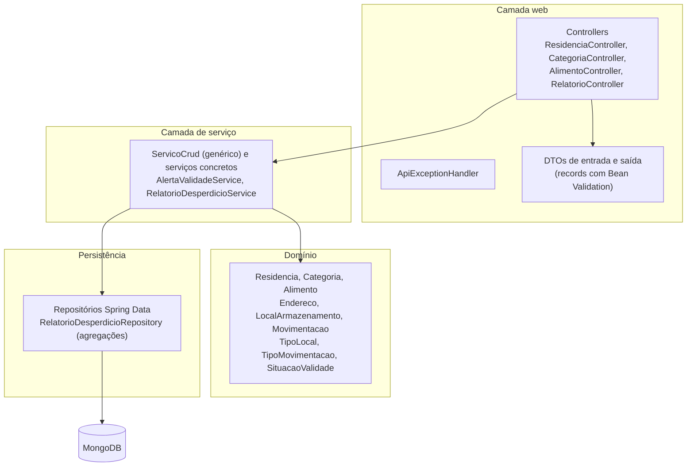
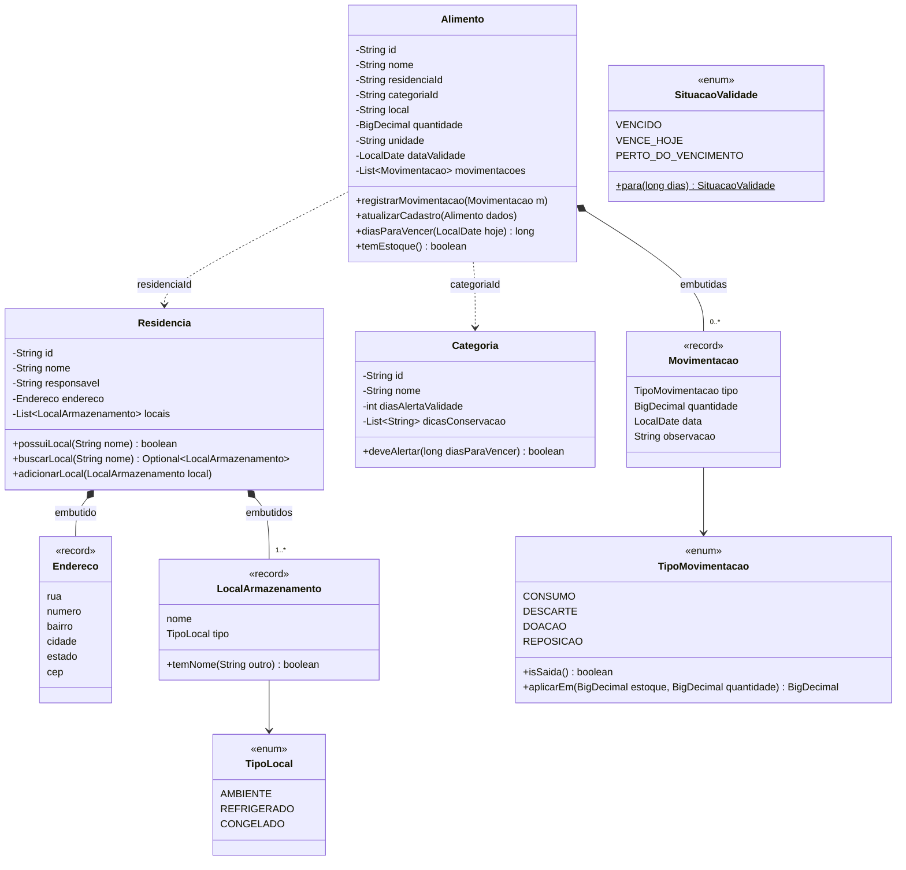
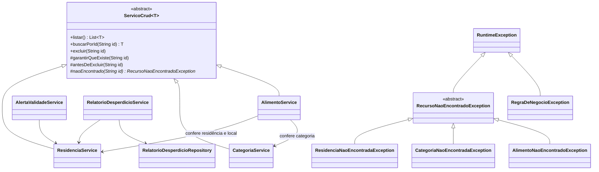
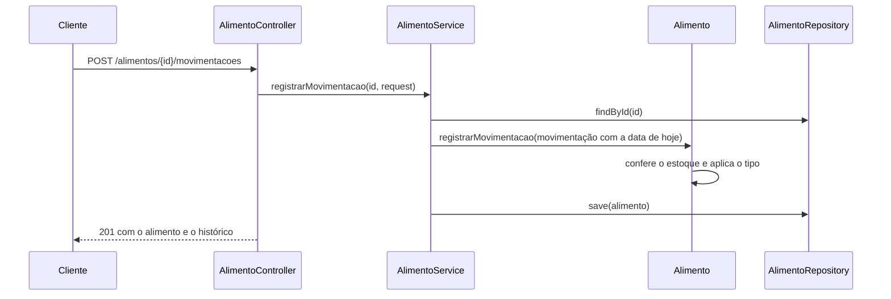

# Arquitetura

O EcoFood é uma API REST em Java 21 com Spring Boot 3.5, organizada em camadas, com as regras de negócio dentro das próprias entidades do domínio.

## Camadas



Uma requisição percorre sempre o mesmo caminho:

1. o controller recebe o JSON e o Spring valida o DTO (`@Valid`);
2. o serviço confere as referências entre coleções e chama o domínio;
3. a entidade aplica a regra de negócio e muda o próprio estado;
4. o repositório grava o documento no MongoDB;
5. qualquer exceção vira uma resposta padronizada no `ApiExceptionHandler`.

## Pacotes

| Pacote | Responsabilidade |
|---|---|
| `config` | Conversão de `BigDecimal` para `Decimal128`, conversor sem o campo `_class`, relógio do sistema (`Clock`) e descrição do Swagger |
| `controller` | Endpoints REST, sem regra de negócio |
| `dto` | Dados de entrada (`*Request`) com a conversão para o domínio, e respostas dos relatórios |
| `model` | Entidades, objetos de valor e enums, com as regras de negócio |
| `service` | Casos de uso e verificação das referências entre coleções |
| `repository` | Acesso ao MongoDB: consultas derivadas e pipelines de agregação |
| `exception` | Hierarquia de erros e tradução para respostas HTTP |

## Diagrama de classes do domínio



As setas cheias com losango são subdocumentos gravados dentro do documento pai. As setas tracejadas são referências por `ObjectId` para outra coleção.

## Serviços e erros



## Orientação a objetos no projeto

| Princípio | Onde aparece |
|---|---|
| **Encapsulamento** | As listas `locais` e `movimentacoes` só podem ser lidas de fora; para mudar, é preciso passar por `adicionarLocal` ou `registrarMovimentacao`, que aplicam as regras. O estoque do `Alimento` só muda por movimentação. |
| **Herança** | `ResidenciaService`, `CategoriaService` e `AlimentoService` herdam de `ServicoCrud<T>` listar, buscar e excluir, sem repetir esse código. As exceções de "não encontrado" herdam de `RecursoNaoEncontradoException`. |
| **Polimorfismo** | Cada serviço implementa `naoEncontrado()` com o seu próprio erro, e `antesDeExcluir()` com a sua trava. O `ApiExceptionHandler` trata `RecursoNaoEncontradoException` uma única vez para as três subclasses. `TipoMovimentacao.aplicarEm()` soma ou subtrai do estoque conforme o tipo, sem `if` no `Alimento`. |
| **Abstração** | `ServicoCrud<T>` define o esqueleto das operações (método modelo) e deixa só os pontos variáveis para as subclasses. |
| **Objetos de valor** | `Endereco`, `LocalArmazenamento` e `Movimentacao` são `record`s imutáveis, sem identidade própria, gravados dentro do documento pai. |
| **Responsabilidade única** | O controller só traduz HTTP; o serviço coordena; a entidade decide a regra; o repositório só acessa o banco. Cada DTO tem um único método de conversão para o domínio (`paraAlimento`, `paraResidencia`, `paraCategoria`, `paraMovimentacao`). |
| **Injeção de dependência** | As dependências chegam pelo construtor, inclusive o `Clock`, o que permite testar regras de data com um relógio fixo. |

## Regras de negócio

| Regra | Onde fica | Resposta |
|---|---|---|
| A residência não pode ter dois locais com o mesmo nome | `Residencia` | 422 |
| O alimento precisa de uma residência e uma categoria existentes | `AlimentoService` | 404 |
| O local do alimento precisa existir na residência (sem diferenciar maiúsculas) | `AlimentoService` + `Residencia.buscarLocal` | 422 |
| Saída (consumo, descarte, doação) não pode passar do estoque | `Alimento.registrarMovimentacao` | 422 |
| Não excluir residência ou categoria com alimentos ligados | `antesDeExcluir` dos serviços | 422 |
| Não remover da residência um local que ainda guarda alimentos | `ResidenciaService.atualizar` | 422 |
| Nome de categoria é único | `CategoriaService` e índice único no MongoDB | 422 ou 409 |
| Alerta quando faltam até `diasAlertaValidade` dias para vencer | `Categoria.deveAlertar` | — |
| Atualizar um alimento não apaga o histórico de movimentações | `Alimento.atualizarCadastro` | — |

## Tratamento de erros

Todas as respostas de erro têm o mesmo formato:

```json
{
  "timestamp": "2026-11-10T19:27:45.229Z",
  "status": 422,
  "mensagem": "Quantidade maior que o estoque disponível: 1.5 L",
  "campos": {}
}
```

| Status | Quando |
|---|---|
| 400 | Campo inválido (`campos` lista cada campo e o motivo, inclusive dentro de subdocumentos, como `endereco.cidade` e `locais[0].nome`) ou JSON malformado |
| 404 | Residência, categoria ou alimento inexistente |
| 409 | O índice único do MongoDB barrou um registro repetido |
| 422 | Dados válidos que violam uma regra de negócio |

## Exemplo de fluxo: registrar uma movimentação


