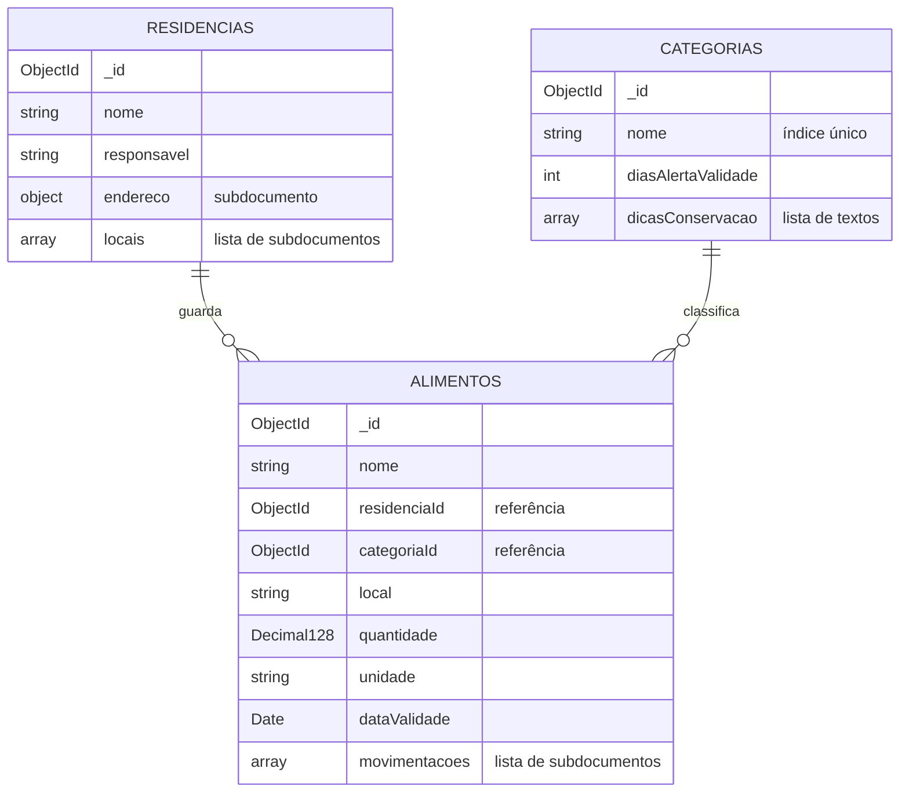

# Banco de dados

O EcoFood usa o **MongoDB**, um banco NoSQL orientado a documentos. Os dados ficam no banco `ecofood`, em três coleções.

## Visão geral



| Coleção | Relacionamento | Objetos complexos |
|---|---|---|
| `residencias` | é referenciada por `alimentos.residenciaId` (1 residência → N alimentos) | `endereco` (subdocumento) e `locais` (lista de subdocumentos) |
| `categorias` | é referenciada por `alimentos.categoriaId` (1 categoria → N alimentos) | `dicasConservacao` (lista) |
| `alimentos` | referencia uma residência e uma categoria | `movimentacoes` (lista de subdocumentos) |

## Coleção `residencias`

Representa a casa (ou família) que guarda os alimentos.

| Campo | Tipo | Obrigatório | Observação |
|---|---|---|---|
| `_id` | ObjectId | sim | gerado pelo MongoDB |
| `nome` | string | sim | |
| `responsavel` | string | sim | |
| `endereco` | subdocumento | sim | `rua`, `cidade` e `estado` (2 letras, gravado em maiúsculas) são obrigatórios; `numero`, `bairro` e `cep` são opcionais |
| `locais` | lista de subdocumentos | sim, pelo menos 1 | cada local tem `nome` e `tipo` (`AMBIENTE`, `REFRIGERADO` ou `CONGELADO`); nomes não se repetem na mesma casa |

```json
{
  "_id": { "$oid": "6af3761d47b97c882d4738f4" },
  "nome": "Casa da família Silva",
  "responsavel": "Ana Silva",
  "endereco": {
    "rua": "Rua das Palmeiras",
    "numero": "120",
    "bairro": "Zona 7",
    "cidade": "Maringá",
    "estado": "PR",
    "cep": "87020-000"
  },
  "locais": [
    { "nome": "Geladeira", "tipo": "REFRIGERADO" },
    { "nome": "Freezer", "tipo": "CONGELADO" },
    { "nome": "Despensa", "tipo": "AMBIENTE" }
  ]
}
```

## Coleção `categorias`

Tipo de alimento. Define com quantos dias de antecedência o vencimento deve ser avisado.

| Campo | Tipo | Obrigatório | Observação |
|---|---|---|---|
| `_id` | ObjectId | sim | |
| `nome` | string | sim | único (índice único e validação sem diferenciar maiúsculas) |
| `diasAlertaValidade` | inteiro | sim | de 0 a 365 |
| `dicasConservacao` | lista de strings | não | |

```json
{
  "_id": { "$oid": "6af3761d47b97c882d4738ef" },
  "nome": "Laticínios",
  "diasAlertaValidade": 3,
  "dicasConservacao": [
    "Manter refrigerado entre 1 °C e 5 °C",
    "Depois de aberto, consumir em até 3 dias"
  ]
}
```

## Coleção `alimentos`

Cada documento é um alimento guardado numa residência, com o histórico de tudo que entrou e saiu.

| Campo | Tipo | Obrigatório | Observação |
|---|---|---|---|
| `_id` | ObjectId | sim | |
| `nome` | string | sim | |
| `residenciaId` | ObjectId | sim | referência para `residencias._id` |
| `categoriaId` | ObjectId | sim | referência para `categorias._id` |
| `local` | string | sim | nome de um dos `locais` da residência, gravado como está cadastrado nela |
| `quantidade` | Decimal128 | sim | estoque atual; muda a cada movimentação |
| `unidade` | string | sim | `kg`, `L`, `un`... |
| `dataValidade` | Date | sim | |
| `movimentacoes` | lista de subdocumentos | não | cada uma tem `tipo`, `quantidade`, `data` e `observacao` (opcional) |

Tipos de movimentação: `CONSUMO`, `DESCARTE` e `DOACAO` tiram do estoque; `REPOSICAO` soma.

```json
{
  "_id": { "$oid": "6af3761d47b97c882d4738fb" },
  "nome": "Tomate",
  "residenciaId": { "$oid": "6af3761d47b97c882d4738f4" },
  "categoriaId": { "$oid": "6af3761d47b97c882d4738f1" },
  "local": "Geladeira",
  "quantidade": { "$numberDecimal": "0.4" },
  "unidade": "kg",
  "dataValidade": { "$date": "2026-11-13T03:00:00Z" },
  "movimentacoes": [
    {
      "tipo": "CONSUMO",
      "quantidade": { "$numberDecimal": "0.4" },
      "data": { "$date": "2026-11-08T03:00:00Z" }
    },
    {
      "tipo": "DESCARTE",
      "quantidade": { "$numberDecimal": "0.2" },
      "data": { "$date": "2026-11-09T03:00:00Z" },
      "observacao": "Dois tomates estragados"
    }
  ]
}
```

## Embutir ou referenciar

A modelagem segue a regra mais usada no MongoDB: **embutir o que pertence ao documento e é lido junto com ele; referenciar o que é compartilhado ou cresce sem limite**.

| Dado | Decisão | Motivo |
|---|---|---|
| Endereço da residência | embutido | só existe junto da residência e é sempre lido com ela |
| Locais de armazenamento | embutidos | são poucos, pertencem à casa e são usados para validar o local de cada alimento |
| Movimentações do alimento | embutidas | pertencem a um único alimento, são lidas com ele e a atualização do estoque e do histórico acontece numa única gravação (atômica no documento) |
| Residência do alimento | referência | uma residência tem muitos alimentos, que são consultados e filtrados separadamente |
| Categoria do alimento | referência | a mesma categoria é compartilhada por muitos alimentos; mudar os dias de alerta de "Laticínios" vale para todos de uma vez, sem atualizar cada alimento |

As referências são gravadas como **`ObjectId`**, o mesmo tipo do `_id` que apontam. Isso permite juntar as coleções com `$lookup` direto no banco (exemplo mais abaixo).

## Tipos de dado

| Tipo no Java | Tipo no MongoDB | Por quê |
|---|---|---|
| `String` com `@Id` | `ObjectId` | identificador gerado pelo banco |
| `String` com `@Field(targetType = OBJECT_ID)` | `ObjectId` | referências do mesmo tipo do `_id` de destino |
| `BigDecimal` | `Decimal128` | quantidades fracionadas (0,4 kg) sem erro de arredondamento; somas exatas nas agregações |
| `LocalDate` | `Date` | datas de validade e de movimentação, que permitem ordenar e filtrar por período |
| `enum` | `string` | `tipo` do local e da movimentação, legíveis no banco |

O campo técnico `_class`, que o Spring grava por padrão, foi desligado (`MongoConfig`), porque cada coleção guarda um único tipo de documento.

## Índices

| Coleção | Índice | Campos | Uso |
|---|---|---|---|
| `categorias` | `nome` (único) | `{ nome: 1 }` | impede categorias repetidas, mesmo em gravações simultâneas |
| `alimentos` | `residencia_validade` | `{ residenciaId: 1, dataValidade: 1 }` | listar os alimentos de uma casa por ordem de validade e gerar os alertas |
| `alimentos` | `categoriaId` | `{ categoriaId: 1 }` | saber se uma categoria está em uso antes de excluí-la |

A aplicação cria os índices ao iniciar (`spring.data.mongodb.auto-index-creation=true`). O script de dados de exemplo cria os mesmos índices, com os mesmos nomes.

## Consultas

As consultas simples são geradas pelo Spring Data a partir do nome do método:

| Método | Consulta no MongoDB |
|---|---|
| `findByResidenciaIdOrderByDataValidadeAsc` | `db.alimentos.find({ residenciaId: ObjectId("...") }).sort({ dataValidade: 1 })` |
| `existsByResidenciaId` | `db.alimentos.findOne({ residenciaId: ObjectId("...") })` |
| `existsByCategoriaId` | `db.alimentos.findOne({ categoriaId: ObjectId("...") })` |
| `findByNomeIgnoreCase` | `db.categorias.findOne({ nome: /^Laticínios$/i })` |

### Agregação: totais do relatório de desperdício

`RelatorioDesperdicioRepository.totaisPorUnidadeETipo` soma as saídas de uma residência por unidade de medida e tipo. As unidades não são misturadas: somar quilos com litros não faria sentido.

```javascript
db.alimentos.aggregate([
  { $match: { residenciaId: ObjectId("6af3761d47b97c882d4738f4") } },
  { $unwind: "$movimentacoes" },
  { $match: { "movimentacoes.tipo": { $in: ["CONSUMO", "DESCARTE", "DOACAO"] } } },
  { $group: {
      _id: { unidade: "$unidade", tipo: "$movimentacoes.tipo" },
      total: { $sum: "$movimentacoes.quantidade" }
  } },
  { $project: { unidade: "$_id.unidade", tipo: "$_id.tipo", total: 1 } },
  { $sort: { unidade: 1, tipo: 1 } }
])
```

Com os dados de exemplo, a aplicação transforma o resultado em:

| Unidade | Consumido | Doado | Descartado | Aproveitamento |
|---|---|---|---|---|
| L | 2 | 0 | 0 | 100,0% |
| kg | 2,4 | 1 | 0,2 | 94,4% |
| un | 8 | 3 | 4 | 73,3% |

Aproveitamento = (consumido + doado) ÷ (consumido + doado + descartado) × 100.

### Agregação: alimentos mais descartados

```javascript
db.alimentos.aggregate([
  { $match: { residenciaId: ObjectId("6af3761d47b97c882d4738f4") } },
  { $unwind: "$movimentacoes" },
  { $match: { "movimentacoes.tipo": "DESCARTE" } },
  { $group: {
      _id: { nome: "$nome", unidade: "$unidade" },
      quantidade: { $sum: "$movimentacoes.quantidade" }
  } },
  { $sort: { quantidade: -1 } },
  { $limit: 5 },
  { $project: { nome: "$_id.nome", unidade: "$_id.unidade", quantidade: 1 } }
])
```

### Juntando as três coleções

Como as referências são `ObjectId`, o `$lookup` funciona direto, sem conversão. Esta consulta não é usada pela API, mas serve para explorar os dados no `mongosh` ou no Compass:

```javascript
db.alimentos.aggregate([
  { $lookup: { from: "categorias", localField: "categoriaId", foreignField: "_id", as: "categoria" } },
  { $lookup: { from: "residencias", localField: "residenciaId", foreignField: "_id", as: "residencia" } },
  { $project: {
      _id: 0,
      alimento: "$nome",
      categoria: { $first: "$categoria.nome" },
      residencia: { $first: "$residencia.nome" },
      local: 1
  } }
])
```

## Integridade entre coleções

O MongoDB não tem chave estrangeira. A integridade das referências fica na camada de serviço:

- ao cadastrar ou atualizar um alimento, a residência e a categoria precisam existir (senão, 404), e o local precisa existir na residência (senão, 422);
- uma residência ou categoria com alimentos ligados não pode ser excluída (422);
- ao atualizar uma residência, os locais que ainda guardam alimentos não podem ser removidos (422).

## Compatibilidade com a 1ª entrega

Os documentos gravados pela versão 1.0 (com `categoria` em texto e sem `movimentacoes`) continuam podendo ser lidos: o campo antigo é ignorado e a lista de movimentações começa vazia. Esse caso é coberto por um teste de integração (`RepositoriosIntegracaoTest`).

## Dados de exemplo

O script [`scripts/dados-exemplo.js`](../scripts/dados-exemplo.js) apaga e recria as três coleções com 5 categorias, 2 residências e 13 alimentos com movimentações:

```bash
mongosh "mongodb://localhost:27017/ecofood" scripts/dados-exemplo.js
```
